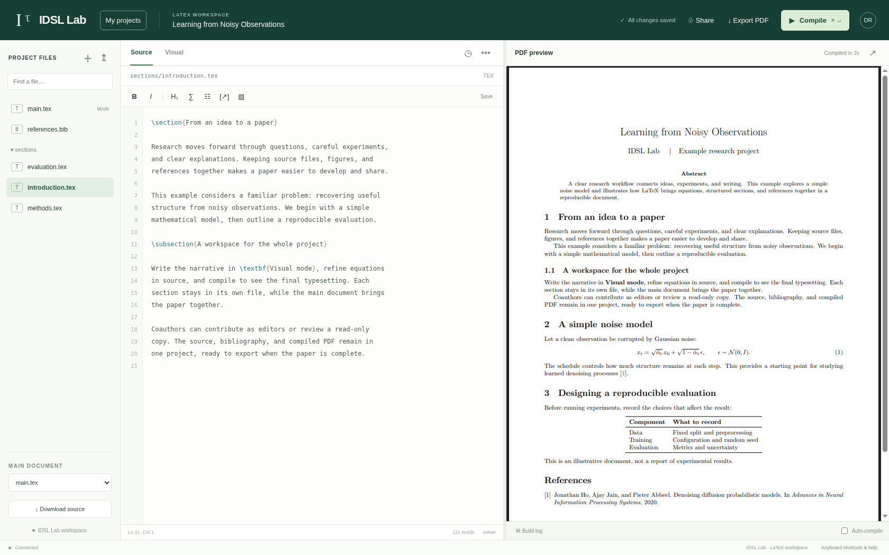
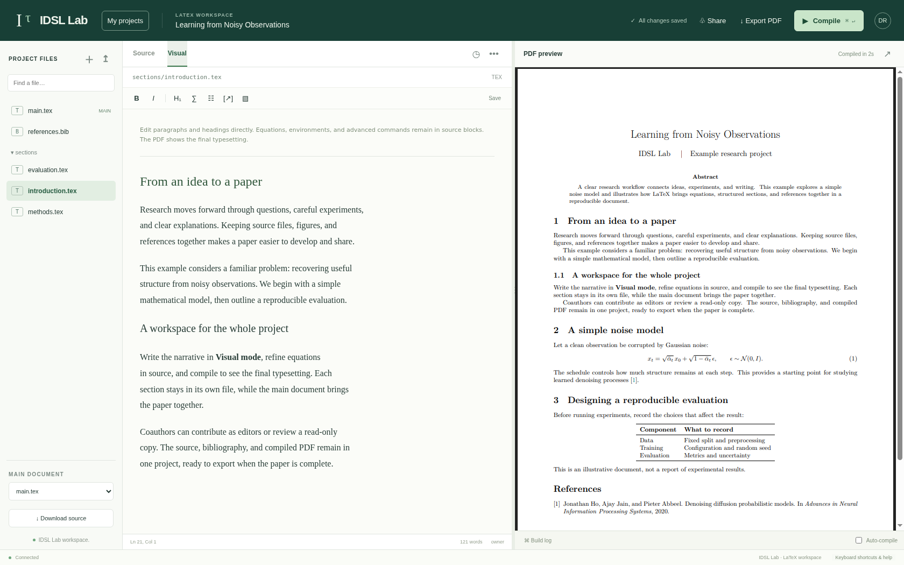
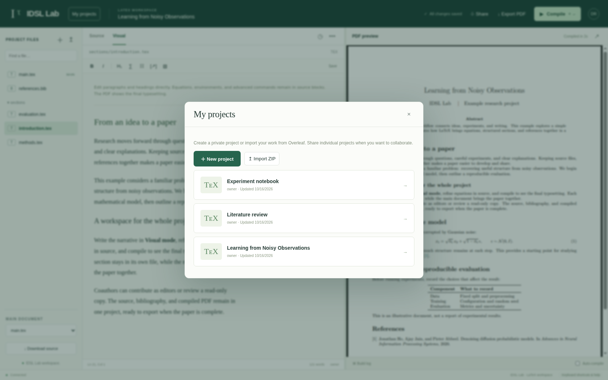
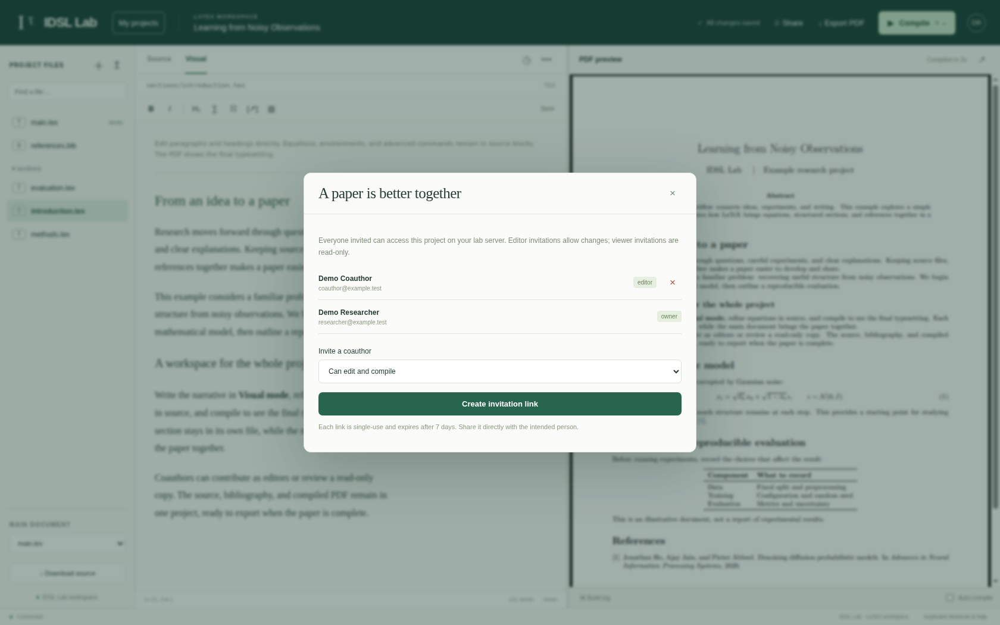

# IDSL Lab LaTeX

A small, self-hosted LaTeX workspace for research groups. Edit source or simple text visually, browse project files, compile in an isolated environment, and preview or download the PDF beside your document.

[Download the latest release](https://github.com/niruhan/idsl-latex/releases/latest) · [Set up your server](#download-and-run) · [See more screenshots](#screenshots)



*Your project files, source, and compiled PDF in one workspace.*

Each member has their own account and private projects. Owners can share individual projects with editors or viewers. Registration requires an administrator-created invitation and an approved email address; no mail service is needed.

**Supported host:** x86_64 Linux with Python 3.10+, systemd user services, cgroup v2, and unprivileged Bubblewrap namespaces. Tested on Ubuntu 22.04. Use a dedicated Linux VM for a public installation. Native Windows/macOS hosting and Docker deployment are not included in this release.

## Screenshots

| Edit visually | Organize your projects | Invite coauthors |
| --- | --- | --- |
| [](docs/images/visual-editor.png) | [](docs/images/projects.png) | [](docs/images/sharing.png) |
| Edit basic headings and paragraphs directly, then compile to check the typesetting. | Keep separate papers and notes, or bring an existing Overleaf project in as a ZIP. | Choose who can edit a paper and who can view it. |

Click a screenshot to view it at full size. These are real captures of the app using a sample paper and fictional demo accounts. They contain no live lab documents, account details, or usable invitation links.

## Download and run

Allow at least **7 GiB free disk space during installation**, about **3 GiB afterward**, and **3 GiB RAM**. The service has a 2 GiB memory limit and uses `/dev/shm` for temporary builds. Setup downloads about 2.9 GB once so compilation can run without network access.

### 1. Install prerequisites

On Ubuntu/Debian:

```bash
sudo apt update
sudo apt install -y python3 bubblewrap ca-certificates fontconfig fonts-dejavu-core git
```

Run the remaining commands as your regular user, **without sudo**. Prefer a dedicated account with no SSH keys, cloud credentials, or unrelated research data.

### 2. Get the app and install the compiler

```bash
git clone https://github.com/niruhan/idsl-latex.git
cd idsl-latex
./labtex setup
./labtex start
```

You can also download the source ZIP from [Releases](https://github.com/niruhan/idsl-latex/releases), extract it, and run `python3 labtex setup` followed by `python3 labtex start` inside the extracted folder. Use `python3 labtex` instead of `./labtex` if your ZIP extractor does not preserve executable permissions.

Setup downloads pinned versions of Tectonic and its TeX package bundle, checks SHA-256 digests, prepares the offline compiler, and checks both isolation and actual PDF compilation. There is no Python virtual environment, npm build, database server, or Conda environment to configure. It does not change firewall rules or bind a public port.

### 3. Create your administrator account

Open **http://127.0.0.1:8765** on the host, and retrieve the one-time setup token:

```bash
./labtex setup-token
```

Paste the token into the first-account form and choose your own name, email, and password (at least 12 characters). This first account is the administrator. There are no default credentials. The token cannot create more accounts after setup.

If the host is a remote server, run this command **on your laptop**, then open the same local URL in your laptop browser:

```bash
ssh -N -L 8765:127.0.0.1:8765 YOUR_USER@YOUR_SERVER
```

If that port is already occupied on the host, start with `./labtex start --port 8877` and substitute `8877` throughout the browser URL and SSH tunnel command.

### 4. Invite members

In the app:

1. Open **Account → Approved emails**, add the members' addresses, and save.
2. Open **Account → Invite lab members** and generate links. The default batch is three.
3. Send one link to each intended member through a trusted channel. Each link expires after seven days and works once.
4. Members enter an approved address and choose their own password. Each gets a private starter project and can create more projects.

Email addresses identify accounts; **email ownership is not verified**. Treat an unused invitation like a temporary password. Anyone holding one could claim an unused approved address. Do not post invitations publicly. You can revoke unused invitations in the same panel. Removing an approved address revokes that member's sessions and login access, while retaining their documents.

The **Share** button inside a project has a different purpose: it grants an existing account editor/viewer access to that project. It does not create an account or expose the owner's other projects. The administrator manages membership but has no special access to other users' documents through the app. The server operator can access the database.

## Share a public HTTPS URL

After creating the administrator locally:

```bash
./labtex start --public
./labtex url
```

This downloads the pinned Cloudflare connector and creates a temporary HTTPS URL. Share the base URL for existing members to sign in; create new invitation links after switching from local to public access so they contain the current hostname.

The connector makes an outbound connection to Cloudflare and forwards requests to `127.0.0.1:8765`. You do not need a domain, Cloudflare account, public listening port, or router port forwarding. Cloudflare terminates HTTPS and processes the proxied traffic; use hosting arrangements that fit your documents' privacy requirements.

The login page is publicly reachable. Authentication and invitations control access to accounts and documents. A hidden URL is not an access control.

[Cloudflare Quick Tunnels](https://developers.cloudflare.com/tunnel/get-started/quick-tunnels/) are intended for trials and have no uptime guarantee. The hostname changes when the connector restarts, including service restarts. Existing accounts and files remain, but old links point at the old hostname. Revoke unused old invitations and issue new ones. For ongoing use, see [a stable domain or private network](docs/HOSTING.md).

To return to local access:

```bash
./labtex start --local
```

## Everyday commands

| Command | Purpose |
| --- | --- |
| `./labtex start` | Start/restart using the saved exposure mode |
| `./labtex start --public` | Enable a temporary public HTTPS URL |
| `./labtex start --local` | Stop the tunnel and use loopback HTTP |
| `./labtex status` | Show the service and resource status |
| `./labtex url` | Print the last generated URL; check status if it is unreachable |
| `./labtex stop` | Stop this installation, retaining accounts and documents |
| `./labtex doctor` | Test prerequisites, isolation, and offline PDF compilation |
| `./labtex test` | Run the automated backend and sandbox tests using temporary databases |
| `./labtex logs` | Show recent private logs; redact before sharing |
| `./labtex uninstall-service` | Remove the service, retaining your data and source |

`start` installs an enabled systemd **user** service with a name unique to this installation folder. To keep it running after logout and start it at boot, have the server administrator enable lingering once:

```bash
sudo loginctl enable-linger "$USER"
```

Keep the installation folder in place. If you move it, uninstall its service first, move the folder, run setup again, and start it from the new location.

## Backups, updates, and passwords

Accounts, source files, history, and PDFs are in `data/labtex.sqlite3`. Deployment settings, compiler files, logs, and the private setup token are in `.local/`. Both directories are excluded from Git and should stay private. Do not share your installed folder as a ZIP.

Create a consistent backup, even while the app is running:

```bash
mkdir -p .local/backups
python3 manage.py backup ".local/backups/labtex-$(date +%Y%m%d-%H%M%S).sqlite3"
```

Copy backups to private storage outside the server. They contain documents and authentication data. See [operations](docs/OPERATIONS.md) for restore and upgrade steps.

There is no email password reset. A trusted server operator can reset an account interactively; the command does not take passwords in its arguments:

```bash
python3 manage.py reset-password member@example.org
```

## Features and limits

- Source editor, project file tree, binary uploads, ZIP import/export, and a PDF preview pane.
- Visual editing for basic LaTeX headings and paragraphs. Use source mode for equations, tables, macros, and complex formatting; this is not a full Overleaf/WYSIWYG replacement.
- Autosave, revision history, and conflict detection. Concurrent edits can conflict; there is no live collaborative cursor or character-level merge.
- Independent projects, account invitations, project invitations, and owner/editor/viewer permissions.
- Offline Tectonic compilation with bibliography support. The package bundle is pinned; shell-escape packages and tools requiring external commands are unsupported.
- One compilation at a time, a five-minute timeout, 8 MiB per file, 40 MiB source per project, 1,000 files per project, and 25 owned projects per account. Uploads/requests and history have additional limits.

See [SECURITY.md](SECURITY.md) for isolation boundaries, residual risks, and safe reporting. No software is attack-proof. Keep the OS and dependencies patched, restrict invitations, and use a dedicated host/VM for internet access.

## Troubleshooting

**Bubblewrap / namespaces unavailable:** the installer stops rather than running an unsandboxed compiler. Some distributions or container hosts restrict unprivileged user namespaces. Ask the host administrator for a supported, narrowly scoped configuration, or use a compatible Linux VM. Do not disable the sandbox or globally weaken kernel security settings to bypass the check.

**Cannot connect to the user bus:** use a normal login/SSH session for the intended service account on a systemd host. Do not run the app under `sudo` or inside a container without a systemd user manager.

**A compile fails:** read the build log in the app, check that the correct main `.tex` file is selected, and run `./labtex doctor`. Unsupported external tools or missing packages may require adapting the project.

**The public page fails after restart:** run `./labtex status`, `./labtex logs`, and `./labtex url`. Wait for the new tunnel to become ready and use its current URL. Check outbound HTTPS connectivity; do not open the backend port to the internet.

## Development and license

Python standard library backend, SQLite storage, plain JavaScript/CSS frontend, and Tectonic for PDF builds. [Development and validation](docs/DEVELOPMENT.md) explains the test suite and release checks. MIT licensed; see [LICENSE](LICENSE). Downloaded dependencies retain their own licenses; see [THIRD_PARTY.md](THIRD_PARTY.md).
