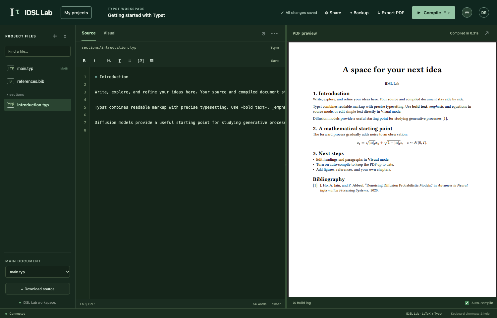

# Local LaTeX + Typst workspace on macOS

Python 3.10 or newer is the runtime prerequisite. Check `python3 --version`; if missing or older, install a current Python 3 from [python.org](https://www.python.org/downloads/macos/). Git is needed only for cloning; a [source ZIP](https://github.com/niruhan/idsl-latex/archive/refs/heads/main.zip) works too. Apple Silicon and Intel Macs are supported. There is no npm build, Docker, database service, or system-wide TeX installation.

```sh
git clone https://github.com/niruhan/idsl-latex.git
cd idsl-latex
./labtex setup
./labtex start
./labtex setup-token
```

Skip the clone step for an existing checkout. If a ZIP extractor loses executable permissions, use `python3 labtex` in place of `./labtex`.

Open **http://127.0.0.1:8765** and create your account using the setup token. Choose your own password. The first account is the administrator; subsequent starts show the sign-in screen. `./labtex start --port 8877` selects another port.

On macOS the launcher automatically uses the local runner. `./labtex local start` is the equivalent explicit command. Linux deployments retain the systemd/Bubblewrap runner; rerun setup there to install the pinned Typst compiler. Linux sandboxed Typst builds are offline: vendor required packages into the project rather than depending on downloads during compilation.

Setup installs pinned, SHA-256-verified **Typst 0.15.1** and **Tectonic 0.17.0** into `.local/bin`. Both are checked with actual PDF compilations, including a bibliography. Tectonic downloads TeX packages as needed; Typst downloads packages when you import them. The first build needs internet access and can take longer. Downloaded packages and compiler configuration stay in `.local/compiler-home`, separate from your normal home directory.

| Command | Purpose |
| --- | --- |
| `./labtex start` | Start in the background; repeated starts reuse the running app |
| `./labtex stop` | Stop while retaining all projects |
| `./labtex status` | Show whether the app is running and its local URL |
| `./labtex setup-token` | Show the private first-account token until setup is complete |
| `./labtex doctor` | Check both compilers using real starter projects |
| `./labtex logs` | Show recent local server logs |
| `./labtex test` | Run backend tests with the installed compilers |

The local server binds only to `127.0.0.1`. It is intended for your own trusted projects on your Mac. It uses Tectonic's untrusted mode, Typst's project root restriction, temporary build directories, a dedicated compiler home, and time/output limits. It does **not** provide the Linux deployment's OS sandbox or resource isolation. Keep shared/public installations on the documented Linux host. Closing the browser retains your files; the server runs until stopped, logout, or restart. Run `start` again after restarting your Mac.

## Your project home

After signing in, you land on the project explorer. Browse cards or switch to a compact list; search by project name or main filename, sort by last edit or name, and filter your own projects, shared projects, LaTeX, or Typst. The view choice is remembered in your browser.


[A compact list view](images/projects-list.png) and [the mobile layout](images/projects-mobile.png) are also available.

Click a project to enter its editor. **My projects** returns to the explorer after saving your edits. Browser Back/Forward and direct project links also work; reloading an editor keeps that project open.

The first home visit creates a private **Getting started with Typst** sample for your account, with an included section, an equation, and bibliography. Click its card or **Open sample** to edit and compile it. Returning home preserves your sample edits and does not create duplicates. Deleting it keeps it deleted until you explicitly choose **Open sample** again. The sample counts toward your 25-project limit and is only added when space is available.

## Appearance

Click the sun/moon button beside your avatar to switch between light and dark with one click. The same button is available before sign-in. To follow your device instead, choose **System** under **Account → Appearance**; this is the default until you pick a theme. The choice is remembered in this browser and synchronizes between its open tabs. The editor theme changes interface colors; PDFs retain the colors defined by the document source.



## Write in either format

Open **My projects → New project** and choose **Typst** or **LaTeX**, then a research starter or a blank document. Imported ZIPs detect `main.typ` or `main.tex`; choose a different entry point under **Main document** when necessary. A project can contain both formats, and changing the main document selects its compiler.

Both formats use the same file tree, autosave, history, source ZIP export, PDF preview, and PDF download. Typst projects enable auto-compile by default; the choice is remembered per project in that browser. Edits made during a build queue another build. Compiler errors with `file:line:column` locations are clickable in the build log.

Visual mode edits simple top-level paragraphs, headings, bold/italic text, and Typst lists. Equations, citations, imports, functions, templates, and advanced formatting remain in source cards. Switching modes preserves untouched source. The formatting toolbar inserts the right syntax for the current language; bold and italic also work on selected visual text. Use Source mode for full control. This is structured block editing with a compiled PDF, not arbitrary PDF editing or complete WYSIWYG layout editing.

Typst projects may use local imports, figures, bibliography files, fonts available on your Mac, and packages from Typst Universe. Compilation starts a fresh CLI process per build; it does not yet use Typst's persistent incremental compiler or source-to-PDF position mapping.

## GitHub backups

The **Backup** button is available to each project owner. Backup settings belong to the signed-in account.

1. Create a GitHub repository (private for private documents). An empty repository or one initialized with a README works.
2. Create a [fine-grained access token](https://github.com/settings/personal-access-tokens/new), select the backup repositories, and grant **Contents: Read and write**. Repositories are created on GitHub, not automatically by this app.
3. Enter your shared repository as `owner/repository`, and optionally a branch. Blank uses the repository's default branch. For a nonempty repository, the selected branch must already exist.
4. Keep **Use my shared repository** for your default layout. Each project gets a stable `projects/PROJECT_ID/` folder, containing its source, assets, and a small `labtex-project.json` manifest with its title and main file.
5. For a separate document repository, select **Use a separate repository for this project** and enter that repository. Its source goes at the root. Other projects can continue using the shared repository.
6. Choose **Back up this project** or **Back up all my projects**. The latter includes only projects you own, and reports each success or failure separately.

The access token is kept only in the current tab's memory and sent to this app when creating a backup; the server forwards it to GitHub over HTTPS. It is never saved in SQLite, logs, localStorage, or sessionStorage. Reloading the tab clears it. You can enable backup **30 seconds after saving while the tab is open**; enter a token again after a reload. Automatic backups pause on errors and show the reason. Closing the tab stops automatic backups. These are source snapshots, not a bidirectional Git sync.

Each snapshot uses the GitHub Git database API: unchanged blobs are reused, binary assets are preserved, deleted/renamed source files are reflected, unrelated repository files are retained, and branch updates never force-push. Concurrent changes or branch protection produce an error, retaining your local documents. A repeat backup with unchanged source produces no new commit. The GitHub commit link appears after a verified branch update. Never treat an error as a successful backup.

The first snapshot refuses to overwrite overlapping files already in the destination. A manifest prevents two projects from adopting the same separate repository. `labtex-project.json` is reserved backup metadata. Project/account deletion in the app never deletes GitHub history. Compiled PDFs, local revisions, accounts, and passwords are excluded. Once source is backed up, future snapshots replace the app-managed source paths; use a separate branch if you also edit those paths directly on GitHub.

To restore source, download the repository ZIP from GitHub. For the shared layout, ZIP the desired `projects/PROJECT_ID/` folder and import it through **My projects → Import ZIP**. For a separate repository, import its ZIP directly. Check the main document after import. SQLite backups are still needed to preserve accounts and local revision history.

## Browser validation

Install Playwright outside this repository and use Node 20 or newer. `tests/run_browser.py` starts a disposable database and runs the project-home, theme, LaTeX, and Typst browser regressions; it never touches `data/` or writes to GitHub.

```sh
PLAYWRIGHT_MODULE=/path/to/node_modules/playwright \
NODE_BIN=/path/to/node \
python3 tests/run_browser.py
```

Set `CHROME_BIN` to an installed Chromium-based browser if Playwright's Chromium is unavailable. Screenshots/PDFs go into ignored `artifacts/`.
