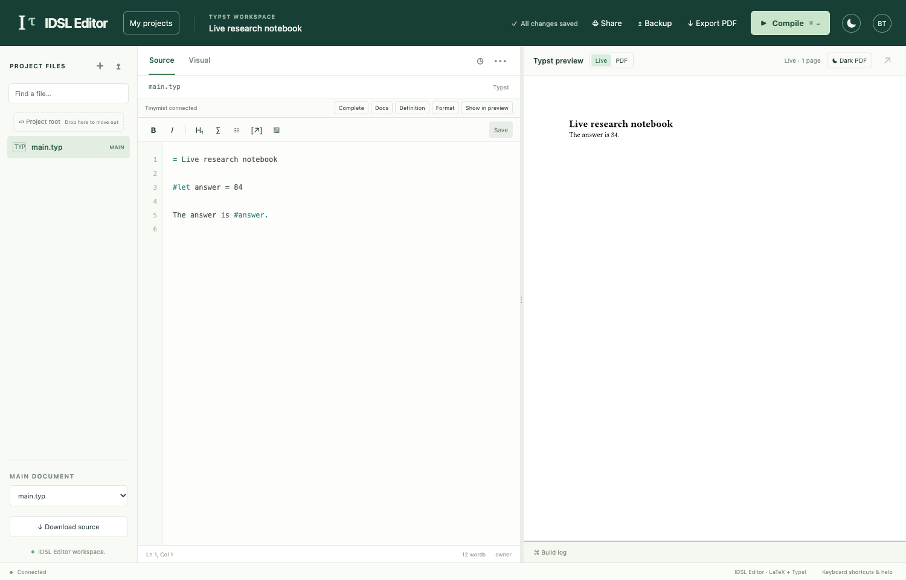

# Local LaTeX + Typst workspace on macOS

Python 3.10 or newer is the runtime prerequisite. Check `python3 --version`; if missing or older, install a current Python 3 from [python.org](https://www.python.org/downloads/macos/). Git is needed only for cloning; a [source ZIP](https://github.com/niruhan/idsl-latex/archive/refs/heads/main.zip) works too. Apple Silicon and Intel Macs are supported. There is no npm build, Docker, database service, or system-wide TeX installation.

```sh
git clone https://github.com/niruhan/idsl-latex.git
cd idsl-latex
./labtex setup
./labtex start
./labtex setup-token
```

Skip the clone step for an existing checkout. If a ZIP extractor loses executable permissions, use `python3 labtex` in place of `./labtex`.

Open **http://127.0.0.1:8765** and create your account using the setup token. Choose your own password. The first account is the administrator; subsequent starts show the sign-in screen. `./labtex start --port 8877` selects another port.

On macOS the launcher automatically uses the local runner. `./labtex local start` is the equivalent explicit command. Linux deployments retain the systemd/Bubblewrap runner; rerun setup there to install the pinned Typst compiler. Linux sandboxed Typst builds are offline: vendor required packages into the project rather than depending on downloads during compilation.

Setup installs pinned, SHA-256-verified **Typst 0.15.1**, **Tectonic 0.17.0**, and **Tinymist 0.15.10** (embedding Typst 0.15.1) into `.local/bin`. Checks include actual PDF compilations, a bibliography, and a real Tinymist compiler/LSP/preview session. To upgrade an existing checkout, stop the app, rerun `./labtex setup`, then start it again. Tectonic downloads TeX packages as needed; Typst downloads packages when you import them. The first build needs internet access and can take longer. Downloaded packages and compiler configuration stay in `.local/compiler-home`, separate from your normal home directory.

| Command | Purpose |
| --- | --- |
| `./labtex start` | Start in the background; repeated starts reuse the running app |
| `./labtex stop` | Stop while retaining all projects |
| `./labtex status` | Show whether the app is running and its local URL |
| `./labtex setup-token` | Show the private first-account token until setup is complete |
| `./labtex doctor` | Check PDF compilers and the Tinymist live service |
| `./labtex logs` | Show recent local server logs |
| `./labtex test` | Run backend tests with the installed compilers |

The local server binds only to `127.0.0.1`. It is intended for your own trusted projects on your Mac. It uses Tectonic's untrusted mode, Typst's project root restriction, temporary build directories, a dedicated compiler home, and time/output limits. It does **not** provide the Linux deployment's OS sandbox or resource isolation. Keep shared/public installations on the documented Linux host. Closing the browser retains your files; the server runs until stopped, logout, or restart. Run `start` again after restarting your Mac.

## Your project home

After signing in, you land on the project explorer. Browse cards or switch to a compact list; search by project name or main filename, sort by last edit or name, and filter your own projects, shared projects, LaTeX, or Typst. The view choice is remembered in your browser.


[A compact list view](images/projects-list.png) and [the mobile layout](images/projects-mobile.png) are also available.

Click a project to enter its editor. **My projects** returns to the explorer after saving your edits. Browser Back/Forward and direct project links also work; reloading an editor keeps that project open.

Open **⋯** on a project card or list row to **Rename**, **Move to folder**, or **Delete** it. Owners and editors can rename; only owners can delete. Deletion requires typing the project name and removes the project and its history for all collaborators. Existing GitHub backups are retained. Viewers can move projects within their own explorer.

The **Getting started with Typst** sample is a regular choice under **More templates**. It contains an included section, an equation, and bibliography. Home visits never add projects automatically; existing sample projects and their edits are preserved.

### Organize projects into folders

Click **New folder** to create a directory in the explorer. Open it to create subfolders, then use the sidebar or breadcrumbs to navigate. Each account can have up to 100 folders, nested up to 10 levels.

Use **⋯ → Move to folder** on a project card or list row to choose its destination, or drag the project onto a folder card, sidebar folder, or breadcrumb. Choose **All projects (root)** to move it out. New projects and ZIP imports start in the folder you currently have open. **Folder settings** lets you rename a folder, change its parent, or delete it once empty.

The root shows folders and projects that have not been filed. Search at the root finds projects in every folder; inside a folder it includes that folder's descendants. **My projects**, **Shared with me**, **Typst**, and **LaTeX** filters search across your whole collection.

Use **Up one level** or **All projects** below the templates to leave a folder. Drag projects or folders onto another folder to move them; dragging onto **All projects** moves them to the root. Folder moves include their descendants and refuse cycles.

Folders belong to your account. Moving a shared project changes only your own explorer; its source, sharing permissions, and other users' layouts stay the same. This organization is stored in SQLite with your projects, rather than as directories of `.typ` or `.tex` files on disk. A database backup preserves it. Source ZIP exports and GitHub backups contain document files, so restore your database to preserve the explorer layout as well.

## Starter templates

Western presentation and NeurIPS remain featured under **Start with a template**. **More templates** opens a separate searchable library for other starters. The gallery is available on every account's project home. Click **Use template** to create your own private, editable copy in the current folder. The templates are also choices under **New project → Start with**, after selecting Typst or LaTeX. Each copy counts toward the 25-project limit; browsing the gallery creates nothing and does not overwrite earlier copies.

- **Western presentation (Typst):** the supplied Western university slide design, with purple colors, logo, section headers, 16:9 slides, Libertinus Serif, and note/discussion helper boxes. Author and department are placeholders. Edit `main.typ`, `shared.typ`, and `sections/`. Touying 0.5.3 is bundled with its license; the slides require no external Typst packages.
- **NeurIPS 2026 paper (LaTeX):** the [official 2026 style](https://neurips.cc/Conferences/2026/CallForPapers) and checklist, with an anonymous Main Track manuscript, bibliography, and appendix. Fill in your own content and checklist answers. The project's README explains preprint/final options and links to the conference guidance.

The library also includes **Getting started with Typst**, **Classic research article (LaTeX)**, **Western thesis scaffold (Typst)**, **Coursework assignment (Typst)**, **Beamer presentation (LaTeX)**, and **Academic CV (Typst)**. The thesis scaffold uses placeholder content and must be checked against current SGPS and program requirements before submission.

The templates contain public starter content, with no personal documents or account details. Creating a copy does not share it with anyone. Original upstream licenses and attribution are included; Western's logo remains its trademark. Interface themes do not change a template's document colors.

Preview the [Western presentation](images/western-presentation.png) and [NeurIPS paper](images/neurips-paper.png).

The account avatar opens a dropdown with **My projects**, **Themes & appearance**, and **Sign out**, plus administrator tools when available.

## Appearance

Open the account avatar and choose **Themes & appearance** to choose **IDSL Forest** (the original), **Western Purple**, **Nord**, **GitHub**, or **Solarized**. Each includes light and dark appearances. Western Purple has a white canvas in light mode, neutral surfaces, and [Western's purple and orchid accents](https://brand.westernu.ca/visual-identity/colours.html). Nord uses cool slate and arctic blue; GitHub uses neutral surfaces and blue accents. Saved Catppuccin/Dracula choices migrate to Nord/GitHub respectively.

The sun/moon button still switches light/dark with one click. In **Account → Themes & appearance**, choose **System** to follow your device. The palette and mode are remembered in this browser, apply before sign-in, and synchronize between its open tabs. Preferences affect the interface; Exported PDFs retain the colors defined by their document source.

[See the theme picker](images/themes.png).


## Write in either format

Open **My projects → New project** and choose **Typst** or **LaTeX**, then a research starter or a blank document. Imported ZIPs detect `main.typ` or `main.tex`; choose a different entry point under **Main document** when necessary. A project can contain both formats, and changing the main document selects its compiler.

Click **Dark PDF** in the preview pane to display the rendered document in dark colors. This choice is remembered separately from the interface theme and works with any palette in light or dark mode. It changes the on-screen preview only; exported PDFs and document source keep their original colors.

Both formats use the same file tree, autosave, history, source ZIP export, and project-named PDF download. On Mac, editable Typst projects open the Tinymist live preview automatically. LaTeX and the Typst PDF fallback retain manual/automatic PDF builds and clickable `file:line:column` errors in the build log.

Source and Visual edits save automatically after a half-second pause, or every five seconds while you keep typing. Leaving a project or switching files waits for the latest save, including browser Back/Forward and **Account → My projects**. Switching tabs or leaving the browser window also triggers a save. A failed save or coauthor conflict keeps the editor open with your draft; temporary connection/server errors retry automatically. Check **All changes saved** before closing the tab. Unsaved drafts remain recoverable in the same browser tab, and the browser warns before leaving with pending changes.

Use **Ctrl+Z** or **Cmd+Z** to undo, and **Ctrl/Cmd+Shift+Z** or **Ctrl+Y** to redo. This works in Source and Visual, including toolbar formatting, Tab indentation, and Typst completions/formatting. Autosave keeps your undo history; each file has its own. Refreshing the page clears this in-memory history. **File history** still provides earlier saved revisions.

Right-click a file in **Project files** for **Download**, **Rename**, **Replace**, or **Delete**. The **•••** file-actions button and **Shift+F10** offer the same menu. Replacement keeps its project path and saves the old version in history; renaming does not update document references. Viewers can only download. Choose another main document before deleting the current one.

Click a folder name or its arrow under **Project files** to collapse or expand it, including nested folders. Your choices are remembered per project in this browser. Root files such as `main.typ` stay at the top. File search reveals matches inside collapsed folders; clearing the search restores your folder layout. Opening a file from search or a compiler diagnostic reveals its parent folders.

Click an image in **Project files** to preview it in the left pane. SVGs and common raster images open in **Preview**; SVGs also offer **Source** for editing. Selecting a document returns to your previous Source/Visual mode.

Visual mode edits simple top-level paragraphs, headings, bold/italic text, and Typst lists. Equations, citations, imports, functions, templates, and advanced formatting remain in source cards. Switching modes preserves untouched source. The formatting toolbar inserts the right syntax for the current language; bold and italic also work on selected visual text. Use Source mode for full control. This is structured block editing with a compiled PDF, not arbitrary PDF editing or complete WYSIWYG layout editing.

Typst projects may use local imports, figures, bibliography files, fonts available on your Mac, and packages from Typst Universe.

Drag files or directories onto a folder in the editor’s file tree, or onto **Project root**. Moves preserve bytes and revision history and update the main-document path. They refuse overwrites and folder merges. Update imports and image references to the old paths yourself. Source ZIP and PDF downloads use the project name.

### Tinymist live editing on Mac

A persistent [Tinymist](https://github.com/Myriad-Dreamin/tinymist) process keeps Typst's incremental compiler and file watcher alive for the open project. Edits reach its in-memory source buffer after a short typing debounce, independently of autosave. Its bundled renderer streams incremental updates over an authenticated WebSocket without rebuilding a PDF or reloading the preview iframe on each edit. Imported files and assets saved in the project are synchronized into its private watched directory. Temporary syntax errors retain the previous good render and show clickable diagnostics above the source.

In **Source** mode, use the Tinymist toolbar:

| Control | Action |
| --- | --- |
| **Complete** / `Ctrl+Space` | Autocomplete at the cursor; arrows select, Enter/Tab accepts, Escape closes |
| **Docs** or click a source symbol | Show documentation and inferred values/types at the cursor |
| **Definition** / `F12` | Open the definition in a project source file |
| **Format** / `Shift+Option+F` | Apply Tinymist's document formatter; autosave/history still apply |
| **Show in preview** | Scroll the live preview to the current source position |
| Click source content in the live preview | Jump back to its source location when Tinymist provides a mapping |
| **Reconnect** | Restart a failed or expired live session |

**Live / PDF** switches between the incremental renderer and a freshly compiled PDF. **Compile** still creates a PDF; **Export PDF** saves and compiles the current source before downloading `PROJECT NAME.pdf`. **Dark PDF** also applies to the live view, independently of the app theme. Exported bytes retain document colors.

The live service uses temporary mirrors; your authoritative source and history remain in `data/labtex.sqlite3`. Leaving the editor or signing out releases its worker. Up to two live tabs per account and three per installation may run; unused sessions expire after three minutes. Close another live tab if the limit is reached.

Tinymist live editing is currently enabled by the **local Mac runner**. Linux shared hosting keeps its existing isolated PDF compiler; view-only projects also use the PDF pane. If Tinymist cannot start, the editor retains PDF compilation. Set `LABTEX_TYPST_LIVE=0 ./labtex start` after stopping the app to deliberately use the PDF fallback. Its Typst auto-compile starts about 150 ms after typing pauses and saves first; LaTeX uses a longer debounce. The fallback's **Auto-compile** checkbox controls those PDF builds.



## GitHub backups

The **Backup** button is available to each project owner. Backup settings belong to the signed-in account.

1. Create a GitHub repository for your documents. Use a private repository for private work.
2. Open the account menu in the project explorer → **GitHub backups**. Its **Create a GitHub access token** link opens GitHub’s token generator. Select your backup repositories and grant **Contents: Read and write**.
3. Enter `owner/repository`, an optional branch, and your token. Leave **Remember token for future sessions** checked, then save settings or run a backup. Saved tokens are reused after reloads, sign-ins, and server restarts without displaying their value.
4. Choose **Back up all to this repository**. Every project you own goes in `projects/PROJECT NAME/`, with its source, assets, and manifest. Shared projects owned by someone else are excluded. This action preserves each project’s separate-repository settings.
5. In the editor’s account menu → **Back up this project** (or the **Backup** toolbar button), choose the shared layout or a separate repository for that document. The separate layout puts its source at the repository root.

The editor’s **Back up this project** popup contains only actions for the open project. Its **Global backup** panel shows the shared repository, the last recorded snapshot, and whether saved changes are pending. **Update this project in global backup** updates only this document’s folder in that repository, even when its normal backup destination is a separate repository; it preserves those separate settings. Every owned project is included when you run all-project backups, but the panel distinguishes that inclusion from a verified snapshot. Shared repository settings and **Back up all** are available only from the project explorer under **Account → GitHub backups**.

On macOS, remembered tokens live in **macOS Keychain**, scoped to this installation and account. If Keychain is locked, unlock it and retry. Linux stores them in private `data/.github-tokens/` files (0600, directory 0700); the server’s OS account can read them. Neither mode puts tokens in SQLite, logs, source ZIPs, GitHub snapshots, localStorage, or sessionStorage. The server sends the token to GitHub over HTTPS only when backing up. **Forget saved token** removes it from this installation without revoking it on GitHub. Uncheck Remember to use a new token only in the current tab’s memory.

You can enable backups **30 seconds after saving while the tab is open**. Automatic backups pause on errors and stop when the tab closes; enable them again after a reload, reusing the saved token. These are source snapshots, not a bidirectional Git sync.

Shared backup folders use readable project names, with unsafe filename characters replaced. Duplicate names receive a stable numbered suffix, such as `My paper (2)`. Existing ID-named folders migrate automatically on the next backup; renaming a project also moves its managed snapshot on its next backup. Moves happen in the same commit as the snapshot. Unrelated files manually added to an old folder are retained there, and earlier versions remain in Git history. Separate-repository backups continue to use the repository root.

Each snapshot uses the GitHub Git database API: unchanged blobs are reused, binary assets are preserved, deleted/renamed source files are reflected, unrelated repository files are retained, and branch updates never force-push. Concurrent changes or branch protection produce an error, retaining your local documents. A repeat backup with unchanged source produces no new commit. The GitHub commit link appears after a verified branch update. Never treat an error as a successful backup.

The first snapshot refuses to overwrite overlapping files already in the destination. A manifest prevents two projects from adopting the same separate repository. `labtex-project.json` is reserved backup metadata. Project/account deletion in the app never deletes GitHub history. Compiled PDFs, local revisions, accounts, and passwords are excluded. Once source is backed up, future snapshots replace the app-managed source paths; use a separate branch if you also edit those paths directly on GitHub.

To restore source, download the repository ZIP from GitHub. For the shared layout, ZIP the desired `projects/PROJECT NAME/` folder and import it through **My projects → Import ZIP**. For a separate repository, import its ZIP directly. Check the main document after import. SQLite backups are still needed to preserve accounts and local revision history.

## Browser validation

Install Playwright outside this repository and use Node 20 or newer. `tests/run_browser.py` starts a disposable database and runs the project-home, project-folder, file-tree, theme/palette, starter-template, LaTeX, and Typst browser regressions; it never touches `data/` or writes to GitHub.

```sh
PLAYWRIGHT_MODULE=/path/to/node_modules/playwright \
NODE_BIN=/path/to/node \
python3 tests/run_browser.py
```

Set `CHROME_BIN` to an installed Chromium-based browser if Playwright's Chromium is unavailable. Screenshots/PDFs go into ignored `artifacts/`.

Add `--live-typst` to run the native Tinymist browser checks, including incremental rendering, language features, and PDF export. The default suite explicitly exercises the PDF fallback.
